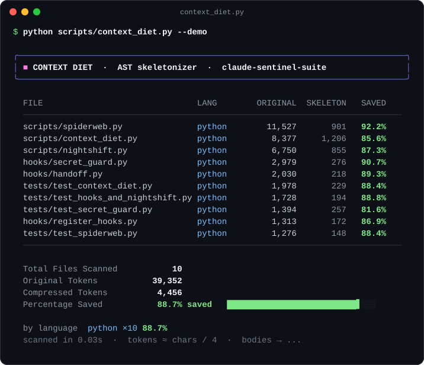
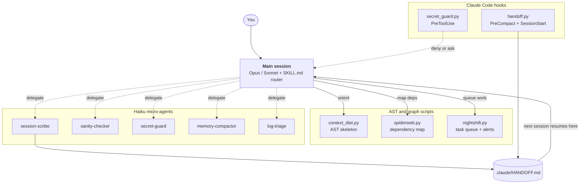
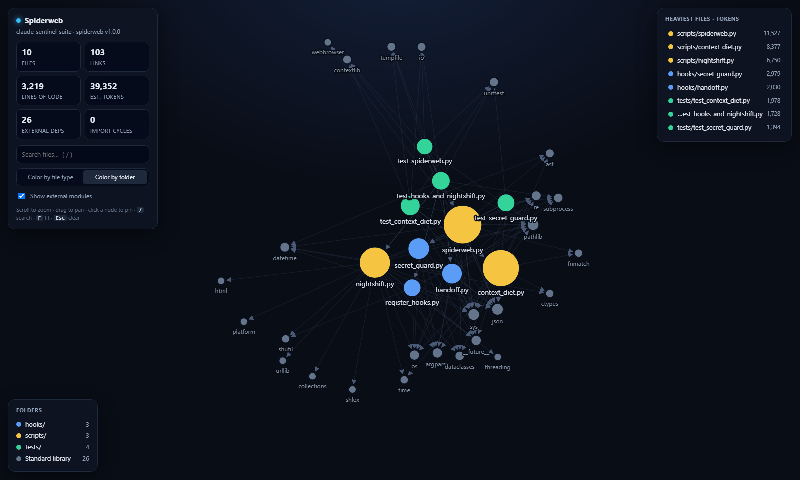

<div align="center">

# 🛡️ claude-sentinel-suite

**Make Claude read your codebase for a fraction of the tokens, never forget where it stopped, and never leak a key.**

AST skeletons · dependency maps · overnight task queues · 5 Haiku micro-agents · safety hooks
<br>Pure Python standard library. Nothing to `pip install`.

[](LICENSE)
[](https://www.python.org/)
[](#-quickstart)
[](https://docs.anthropic.com/en/docs/claude-code)
[](https://github.com/Eminn59/claude-sentinel-suite/actions/workflows/ci.yml)



</div>

---

## Why

Most of a Claude Code session's tokens go to **reading code to find out what is where**: whole files opened to learn one signature, the same modules re-read after every compaction, 2,000-line logs pasted to find one line. Then the session hits its limit and the next one starts from zero.

Sentinel Suite attacks the three biggest leaks:

| Problem | What eats the context | Sentinel fix |
|---|---|---|
| **Context bloat** | Reading full files just to learn the structure | `context_diet.py` gives Claude an AST skeleton: **72–89% fewer tokens** (measured below) |
| **Context rot** | Huge tool outputs and logs stay in the conversation | `memory-compactor` and `log-triage` Haiku agents distill them to ~10 lines |
| **Session-limit amnesia** | A new session re-explores everything | `session-scribe` and the hooks keep `.claude/HANDOFF.md` current; new sessions resume from it automatically |

…plus `spiderweb.py` (see the architecture), `nightshift.py` (queue work overnight, get pinged on your phone) and a **secret-guard hook** that actually blocks `rm -rf ~` and hard-coded API keys before they happen.

## 📊 Benchmarks (measured, reproducible)

`context_diet.py` on real, well-known codebases. Tokens are estimated as characters ÷ 4. Run the same command on the same version and you get the same numbers.

| Codebase | Files | Full source | Skeleton | Saved |
|---|---:|---:|---:|---:|
| CPython 3.14 `Lib/json` | 6 | 12,866 | 1,649 | **87.2%** |
| CPython 3.14 `Lib/http` | 5 | 55,378 | 8,787 | **84.1%** |
| CPython 3.14 `Lib/email` | 29 | 97,670 | 15,873 | **83.7%** |
| CPython 3.14 `Lib/asyncio` | 35 | 132,803 | 22,310 | **83.2%** |
| npm CLI 11.20 `lib/` (JavaScript) | 137 | 134,623 | 38,015 | **71.8%** |

**A realistic session** (orient in `asyncio`, then read in full only the three files you will change):

| Approach | Tokens read | |
|---|---:|---|
| Standard: open every module to understand the package | 132,803 | |
| With Sentinel Suite: skeleton + `base_events.py`, `tasks.py`, `streams.py` in full | 59,933 | **−54.9%** |

The rule that makes this safe: **orient from the skeleton, edit from the real file.** `SKILL.md` teaches Claude exactly that. Cost scales linearly with input tokens, so the percentages carry over to your bill at whatever your model's input price is.

Validation: every one of the 1,874 parseable `.py` files in the CPython 3.14 standard library produces a skeleton that is itself valid Python, and no file among the 1,117 `.js` files of npm (including its `node_modules`) grows.

## 🏗️ Architecture



Opus or Sonnet stays the orchestrator. Mechanical, high-volume work (summarizing logs, auditing diffs, writing the handoff) goes to **Haiku sub-agents** that run in their own context window, so their input never pollutes yours. Anything that must *always* happen (blocking a destructive command, snapshotting state before compaction) is a **hook**, because hooks run every time and a prompt can be forgotten.

## 🚀 Quickstart

**Windows (PowerShell)**

```powershell
git clone https://github.com/Eminn59/claude-sentinel-suite.git
cd claude-sentinel-suite
powershell -ExecutionPolicy Bypass -File .\install.ps1 -WithHooks
```

**macOS / Linux**

```bash
git clone https://github.com/Eminn59/claude-sentinel-suite.git
cd claude-sentinel-suite
./install.sh --with-hooks
```

Restart Claude Code. That's it.

| The installer… | Where |
|---|---|
| links the skill (`SKILL.md`, scripts, hooks) | `~/.claude/skills/sentinel-suite` (symlink / junction: `git pull` updates it) |
| installs the 5 agents | `~/.claude/agents/*.md` |
| with `--with-hooks` / `-WithHooks`: registers the hooks | `~/.claude/settings.json` (backed up first, existing hooks kept, safe to re-run) |

Remove everything with `./install.sh --uninstall` or `.\install.ps1 -Uninstall`. Requirements: Python 3.10+ and Claude Code. `CLAUDE_CONFIG_DIR` is honored.

## 🧰 The tools

### `context_diet.py`: AST skeletonizer

```bash
python scripts/context_diet.py --target ./src --output .claude/skeleton.md
python scripts/context_diet.py --demo                 # benchmark this repo (the image above)
python scripts/context_diet.py --target . --json      # per-file token counts
python scripts/context_diet.py --target . --svg report.svg   # README-ready terminal screenshot
```

- **Python** via the `ast` module: keeps imports, `if TYPE_CHECKING` blocks, class hierarchies, decorators, signatures with type annotations, class attributes, short constants and docstring summaries (`--docstrings full|summary|none`). Bodies become `...`.
- **JavaScript / TypeScript / Go / Rust** via a brace-aware lexer that understands strings, template literals with `${}` nesting, regex literals, comments, Rust lifetimes and raw strings. Function, method, arrow and closure bodies become `{ ... }`; classes, interfaces, structs, impls, enums and object/type literals stay.
- Skips `node_modules`, `.venv`, `dist`, `target`, minified bundles, generated protobuf files and anything over 1 MB; add your own with `--exclude 'GLOB'`.

<details>
<summary>What a skeleton looks like</summary>

```python
def skeletonize_python(source: str, doc_mode: str='summary') -> str:
    """Return the skeleton of a Python module: every function body becomes ``...``."""
    ...

def classify_block(header: str, lang: str) -> str:
    """Decide whether the block opened after ``header`` is a body to collapse or a scope to keep."""
    ...

@dataclass
class FileResult:
    path: str
    language: str
    original_chars: int
    skeleton: str

    @property
    def saved_pct(self) -> float: ...
```

```javascript
class ArboristCmd extends BaseCommand {
  get isArboristCmd () { ... }

  static params = [
    'workspace',
    'workspaces',
    'include-workspace-root',
    'install-links',
  ]

  constructor (npm) { ... }

  async execWorkspaces (args) { ... }
}
```
</details>

### `spiderweb.py`: interactive dependency map

```bash
python scripts/spiderweb.py --target . --open
```

```text
✔ spiderweb  137 files · 648 links · 73 external modules · 1 import cycle
  15,223 lines of code · ~134,623 tokens
  → sentinel_spiderweb.html  (97 KB)
  ↻ cycle: npm.js → utils/did-you-mean.js → utils/error-message.js → npm.js
```

One self-contained HTML file (D3 v7 from cdnjs): force-directed graph, search (`/`), zoom and pan, drag, hover tooltips with lines of code, file size, **token weight** and inbound/outbound imports, click-to-pin neighborhoods, color by file type or by folder, toggleable stdlib/third-party nodes, a "heaviest files" panel, and **import cycles drawn in red**. Imports are resolved for Python (absolute, relative, packages), JS/TS (relative, `index.*`, `.js`→`.ts`, `@/` aliases), Go (via `go.mod`) and Rust (`mod`, `use crate::/super::/self::`). Add `--json deps.json` to get the raw graph for Claude.

<p align="center">

<br><sub>npm CLI's <code>lib/</code>: 137 files, colored by folder. The red edges are a real import cycle the tool found.</sub>
</p>

<details>
<summary>This repository mapped by itself</summary>
<p align="center"></p>
</details>

### `nightshift.py`: overnight task runner with phone alerts

Write a checklist, go to sleep, wake up to a Discord or Telegram message.

```markdown
<!-- TASKS.md -->
- [ ] Run the test suite: `pytest -q`
- [ ] claude: Fix every failing test in tests/ and list the root causes in FIXES.md
- [ ] `npm run build`
```

```bash
export NIGHTSHIFT_DISCORD_WEBHOOK="https://discord.com/api/webhooks/…"   # or NIGHTSHIFT_TELEGRAM_TOKEN + _CHAT_ID
python scripts/nightshift.py --tasks TASKS.md --mark-done --stop-on-fail \
  --claude-flags "--allowedTools 'Edit,Bash(pytest:*)'"
python scripts/nightshift.py --dry-run          # simulate + preview the webhook payloads
```

```text
  🌙 NIGHTSHIFT  v1.0.0  ·  dry run
  3 task(s) queued · alerts: none

   1. shell  Run the test suite
   2. claude Fix the flaky timeout in tests/test_api.py
   3. shell  Production build

  PASS   1. Run the test suite                                       2.6s
        ████████░░░░░░░░░░░░░░░░ 1/3
  PASS   2. Fix the flaky timeout in tests/test_api.py               4.2s
        ████████████████░░░░░░░░ 2/3
  PASS   3. Production build                                         3.1s
        ████████████████████████ 3/3

  3/3 passed  ·  total 9.9s
```

Backticked items run as shell commands; `claude:` items (or plain text) run as `claude -p` headless prompts. Every run writes a full log and a JSON summary to `.nightshift/`. Alerts are rich Discord embeds (color-coded, per-task fields, the tail of failing output) or Telegram HTML messages, sent with `urllib.request` and retried on rate limits. Options: `--notify-each`, `--timeout`, `--cwd`, `--test-webhook`.

> Headless Claude only does what its permissions allow. Scope `--allowedTools` to what the queue needs; the suite never suggests skipping permissions.

## 🤖 The Haiku micro-agents

Installed to `~/.claude/agents/`. Claude delegates to them on its own (their descriptions say when), or you can ask: *"use log-triage on ci.log"*.

| Agent | Delegated when | Returns |
|---|---|---|
| [`session-scribe`](agents/session-scribe.md) | context is getting long, a milestone is done, you say "wrap up" | `.claude/HANDOFF.md` with **Current Objective · Completed Steps · Modified Files · Pending Blockers · Next Exact Command** |
| [`sanity-checker`](agents/sanity-checker.md) | after multi-file edits, before commits | `SANITY: PASS/WARN/FAIL`: deleted code, `// ... rest unchanged` stubs, vanished functions with live callers, broken imports, truncated files |
| [`secret-guard`](agents/secret-guard.md) | before commit/push, before destructive commands | `SECRETS: CLEAN/LEAK/RISK` with masked findings and rotation advice |
| [`memory-compactor`](agents/memory-compactor.md) | any output over ~200 lines | a ≤40-line state snapshot that keeps exact errors, paths and numbers |
| [`log-triage`](agents/log-triage.md) | logs and stack traces over ~100 lines, CI failures | root cause, `file:line`, the fix, and the command that verifies it |

Each agent has a strict input/output schema and a worked example, so a small model gives consistent, parseable answers.

## 🔒 The hooks

| Hook | Event | Behavior |
|---|---|---|
| `secret_guard.py` | `PreToolUse` (Bash, Read, Write, Edit, MultiEdit) | **Denies** `rm -rf /` `~` `$HOME`, `mkfs`, `dd of=/dev/sd*`, fork bombs, `format C:`, live-looking API keys written into code, and reads of `.env`, SSH keys and `.pem`. **Asks first** for force push, `reset --hard`, `git clean -f`, `DROP TABLE`, `curl … \| sh`, dumping env vars, touching `.env`. |
| `handoff.py precompact` | `PreCompact` | Refreshes the Modified Files list in HANDOFF.md from `git status`, or seeds a HANDOFF.md from your last request if none exists. |
| `handoff.py session-start` | `SessionStart` | Injects HANDOFF.md into the new session so Claude resumes instead of re-exploring. |

```bash
python hooks/secret_guard.py --check "git push --force origin main"
# {"action": "ask", "reason": "Risky command: force push (use --force-with-lease). Confirm that this is intended."}
python hooks/secret_guard.py --check-file src/config.py     # exit 1 if a credential is found
```

Detected credentials: Anthropic, OpenAI, AWS, GitHub, Slack, Google, Stripe live, Hugging Face, npm, Telegram bot tokens, Discord/Slack webhooks, PEM private keys, and generic `password = "…"` assignments (placeholders like `your-key-here` and `${VAR}` are ignored). Set `SENTINEL_GUARD_DISABLE=1` to switch it off for a session.

## 📁 Repository layout

```text
claude-sentinel-suite/
├── SKILL.md                    # routing rules Claude Code loads as the "sentinel-suite" skill
├── agents/                     # 5 Haiku sub-agents (YAML frontmatter + system prompt)
├── scripts/
│   ├── context_diet.py         # AST skeletonizer
│   ├── spiderweb.py            # dependency map → sentinel_spiderweb.html
│   └── nightshift.py           # task queue + Discord/Telegram alerts
├── hooks/
│   ├── secret_guard.py         # PreToolUse guard
│   ├── handoff.py              # PreCompact + SessionStart handoff
│   └── register_hooks.py       # merges hooks into settings.json (install/uninstall)
├── tests/                      # unittest suite (35 tests)
├── install.sh · install.ps1    # one-command installers
└── TASKS.example.md            # nightshift queue template
```

## ⚖️ Honest limitations

- Token counts are estimates (characters ÷ 4), not tokenizer output. Real tokenizers differ by language and content; the *ratios* are what matter.
- The JS/TS/Go/Rust skeletonizer is a lexer with heuristics, not a full parser. Unusual syntax can leave a body uncollapsed (costs tokens, never correctness: the skeleton is for orientation only).
- spiderweb resolves static imports. Dynamic imports with computed paths, Python `importlib` tricks and TS `paths` beyond `@/` and `~/` are not followed.
- Hooks are a safety net, not a sandbox. Keep Claude Code's own permission settings in place.

## 🧪 Development

```bash
python -m unittest discover -s tests -v
```

CI runs the suite on Linux, macOS and Windows with Python 3.10, 3.12 and 3.13. Each script is a single standalone file: copy any one of them into another project and it works.

## License

[MIT](LICENSE)
